# 🛡️ Awesome OAuth 2.0 & Token Authentication Service

  
  
  
  
  
  

**A curated, production-ready directory of top OAuth 2.0, OpenID Connect (OIDC), and Token Authentication Service solutions.** Explore enterprise-grade hosted SaaS identity providers, battle-tested open-source token authorization servers, passkey & WebAuthn services, pricing benchmarks, and free tier limits for modern cloud applications, microservices, and AI agents.

---

## 📑 Table of Contents

- [🌐 Sector Overview & Market Dynamics](#-sector-overview--market-dynamics)
- [☁️ SaaS / Hosted Platforms](#️-saas--hosted-platforms)
- [💻 Open-Source Software](#-open-source-software)
  - [1. Keycloak](#1-keycloak)
  - [2. Authelia](#2-authelia)
  - [3. Authentik](#3-authentik)
  - [4. Ory Hydra](#4-ory-hydra)
  - [5. Zitadel](#5-zitadel)
  - [6. SuperTokens](#6-supertokens)
  - [7. Logto](#7-logto)
  - [8. Casdoor](#8-casdoor)
  - [9. Ory Kratos](#9-ory-kratos)
  - [10. Dex](#10-dex)
  - [11. Hanko](#11-hanko)
  - [12. OpenIddict](#12-openiddict)
  - [13. node-oidc-provider](#13-node-oidc-provider)
  - [14. Duende IdentityServer](#14-duende-identityserver)
  - [15. FusionAuth Community](#15-fusionauth-community)
  - [16. Idenplane](#16-idenplane)
- [📊 Comparison Matrix at a Glance](#-comparison-matrix-at-a-glance)
- [💖 Support](#-support)
- [📈 Star History](#-star-history)
- [🤝 Contributing](#-contributing)
- [📄 License](#-license)

---

## 🌐 Sector Overview & Market Dynamics

> 📈 **Market Size & Growth:** The global Customer Identity and Access Management (CIAM) and token authorization services market is estimated at **$12.0B to $13.3B** and is projected to expand beyond **$30B to $43B** at a robust CAGR of **11% to 17%**.
> 
> 🧩 **Market Concentration & Dynamics:** The sector is **moderately to highly fragmented** rather than winner-take-all. While publicly traded mega-vendors (like Okta/Auth0 and Microsoft Entra ID) dominate large-scale enterprise compliance, high friction and price escalation have catalyzed rapid fragmentation across developer-first innovators (Clerk, Stytch, Descope) and powerful, self-hosted open-source authorization servers (Keycloak, Ory, Casdoor, Zitadel).

---

## ☁️ SaaS / Hosted Platforms

The table below benchmarks leading cloud-hosted, managed OAuth 2.0 and token authentication platforms. Entries are sorted descending by company scale (market capitalization, valuation, or annual revenue).

| 🏢 Platform | 🏷️ Category / Primary Focus | 💰 Starting Tier Price | 🎁 Free Tier / Free Trial Limits | 📈 Scale (Valuation / Revenue) |
|---|---|---|---|---|
| **[Okta Customer Identity Cloud](https://www.okta.com/customer-identity/)** | Enterprise CIAM & Workforce Federation | **$35 / month** (Essentials B2C tier) | **25,000 MAUs free forever** (unlimited social logins, 1 custom domain, standard rate throttling) | **~$31B Market Cap** (~$2.9B ARR) |
| **[Auth0](https://auth0.com/)** | Developer-first CIAM with Rules & Actions | **$35 / month** (Essentials tier; B2B starts at $150/mo) | **25,000 MAUs free forever** (unlimited social logins, basic MFA, 1 custom domain, community support) | **$6.5B Acquisition Value** (Okta subsidiary) |
| **[Stytch](https://stytch.com/)** | Passwordless-first & API-native auth platform | **$99 / month** (Standard platform base fee + usage) | **10,000 MAUs free forever** (includes 5 SSO/SCIM connections, 10,000 device fingerprints, 1,000 M2M tokens) | **~$1.0B Valuation** (Acquired by Twilio) |
| **[Clerk](https://clerk.com/)** | Drop-in React/Next.js authentication UI components | **$25 / month** (Pro plan base; $20/mo billed annually) | **50,000 Monthly Retained Users (MRUs) free forever** (unlimited applications, 3 admin seats, standard UI) | **~$332M Valuation** ($104M+ raised) |
| **[Descope](https://www.descope.com/)** | No-code visual drag-and-drop workflow CIAM | **$120 / month** (Pro plan for scaling tenants/SSO) | **7,500 MAUs free forever** (includes up to 10 tenants, 3 SSO connections, visual flow builder) | **~$250M–$500M Est. Valuation** ($88M raised) |
| **[FusionAuth Cloud](https://fusionauth.io/)** | Dedicated single-tenant managed IAM deployment | **$162 / month** (Starter plan billed annually / $180/mo) | **14-day free trial** (single-tenant dedicated cloud sandbox, no credit card required) | **~$10M–$25M Est. ARR** (Bootstrapped/Profitable) |

---

## 💻 Open-Source Software

Self-hosted, community-driven OAuth 2.0 and token authorization software. Repositories are ranked descending by GitHub Stars_Count, featuring real-time stargazers badges.

### 1. Keycloak

* **Stack:** Java (Quarkus) | **License:** Apache-2.0
* **Overview:** 🌟 Keycloak is the most widely adopted open-source identity and access management platform, providing OAuth 2.0, OpenID Connect (OIDC), SAML 2.0, and WebAuthn/passkeys with LDAP/Active Directory federation. It is the most complete general-purpose IdP with extensive extension points through Java Service Provider Interfaces (SPIs). Keycloak natively supports RFC 8693 token exchange, UMA 2.0, FAPI, and Pushed Authorization Requests (PAR).
* **Trade-off:** ⚠️ Java/Quarkus runtime requires JVM memory tuning and Infinispan cluster caching; resource footprint is significantly higher than lightweight Go alternatives.
* **Best for:** 🎯 Organizations needing an enterprise-grade, standards-complete IAM platform backed by CNCF and Red Hat.

### 2. Authelia

* **Stack:** Go / React | **License:** Apache-2.0
* **Overview:** 🌟 Authelia is an open-source authentication and authorization server providing two-factor authentication and single sign-on (SSO) for web applications through reverse proxy integration (Traefik, Nginx, Caddy, Envoy) and certified OpenID Connect (OIDC) provider capabilities. It seamlessly validates sessions, passes user headers, and acts as a lightweight gatekeeper.
* **Trade-off:** ⚠️ Primarily architected for reverse-proxy-forward authentication; less focused on complex consumer federation or granular OAuth2 custom grant plugins.
* **Best for:** 🎯 Homelabs, internal enterprise portals, and teams protecting internal microservices behind reverse proxies.

### 3. Authentik

* **Stack:** Python / Go | **License:** MIT core / Enterprise
* **Overview:** 🌟 Authentik delivers the most customizable authentication flow and stage engine among open-source IAM solutions. Administrators can construct custom login, recovery, and enrollment stages using graphical flows and Python expressions. Features include OAuth 2.0, OIDC, SAML, LDAP outpost, RADIUS outpost, SCIM directory synchronization, and built-in reverse proxy outpost functionality.
* **Trade-off:** ⚠️ Advanced enterprise multi-tenancy and high-availability clustered caching features require enterprise licensing tiers.
* **Best for:** 🎯 Teams requiring intricate, conditional login workflows with native reverse-proxy integration.

### 4. Ory Hydra

* **Stack:** Go | **License:** Apache-2.0
* **Overview:** 🌟 Ory Hydra is a hardened, OpenID Certified OAuth 2.0 Authorization Server and OpenID Connect Provider built strictly as a headless engine. It does not provide user management or login forms; instead, it implements the OAuth 2.0 / OIDC protocol spec over your existing user database via clean REST APIs. Supports RFC 8693 token exchange, DPoP, and relationship-based access control via Ory Keto.
* **Trade-off:** ⚠️ Headless by design; you are responsible for implementing, hosting, and securing the user authentication and consent screens.
* **Best for:** 🎯 Engineering teams adding high-throughput, low-latency OAuth2/OIDC token issuance to existing custom databases.

### 5. Zitadel

* **Stack:** Go / TypeScript | **License:** AGPL-3.0
* **Overview:** 🌟 Zitadel is a cloud-native identity platform designed specifically for multi-tenant B2B SaaS architectures. Organizations, projects, and self-service capabilities are built in as first-class primitives. Zitadel supports OIDC, SAML, passkeys, MFA, SCIM 2.0 server ingestion, and RFC 8693 token exchange with an event-sourced audit log architecture.
* **Trade-off:** ⚠️ AGPL-3.0 license requires consideration for proprietary modifications; smaller community than Keycloak.
* **Best for:** 🎯 Multi-tenant B2B SaaS applications requiring native tenant branding and self-service management.

### 6. SuperTokens

* **Stack:** Java (Core) / TypeScript SDKs | **License:** Apache-2.0
* **Overview:** 🌟 SuperTokens is a modular, developer-centric open-source alternative to Auth0 and AWS Cognito. It provides recipe-based architecture for session management, social login, passwordless OTP, email/password, MFA, and OAuth 2.0/OIDC. It is famous for its battle-tested, rotating refresh token mechanism preventing session hijacking.
* **Trade-off:** ⚠️ Hybrid core architecture with modular SDK recipes requires integrating front-end and backend libraries specific to the framework.
* **Best for:** 🎯 Modern web/mobile developers needing end-to-end SDKs with robust JWT and cookie-based session security.

### 7. Logto

* **Stack:** TypeScript / Node.js | **License:** AGPL-3.0 / Commercial
* **Overview:** 🌟 Logto is a modern open-source identity verification and CIAM platform designed as a contemporary open-source alternative to Auth0 and Clerk. It provides drop-in sign-in UI, multi-tenancy, RBAC, OIDC/OAuth 2.0 token service, WebAuthn passkeys, and extensive connectors for SMS, email, and social providers.
* **Trade-off:** ⚠️ AGPL-3.0 core license; younger ecosystem compared to established veterans like Keycloak.
* **Best for:** 🎯 TypeScript and Node.js teams desiring an attractive, polished UI with modern developer tooling.

### 8. Casdoor

* **Stack:** Go / React | **License:** Apache-2.0
* **Overview:** 🌟 Casdoor is a UI-driven open-source IAM platform packaged as a single Go binary with a React management console. Supporting OAuth 2.0, OIDC, SAML, CAS, LDAP, RADIUS, and SCIM, it features over 70 built-in global social identity providers. Uniquely, Casdoor includes a built-in Model Context Protocol (MCP) server and OAuth 2.1 authorization server designed for AI agents.
* **Trade-off:** ⚠️ Some advanced financial-grade profiles (FAPI, UMA 2.0, PAR) are still maturing compared to Keycloak.
* **Best for:** 🎯 Teams needing an easy-to-deploy Go IAM solution with extensive social login integrations and native AI agent (MCP) support.

### 9. Ory Kratos

* **Stack:** Go | **License:** Apache-2.0
* **Overview:** 🌟 Ory Kratos is an API-first identity and user management system that handles registration, login, profile updates, multi-factor authentication (TOTP, WebAuthn), and account recovery. Designed to complement Ory Hydra, Kratos owns the user directory and identity lifecycle while Hydra handles the OAuth2/OIDC token issuance.
* **Trade-off:** ⚠️ Headless API architecture; requires deploying a separate frontend application to render forms and UI flows.
* **Best for:** 🎯 Developers building completely custom, brand-tailored authentication flows who want hardened backend identity handling.

### 10. Dex

* **Stack:** Go | **License:** Apache-2.0
* **Overview:** 🌟 Dex is a lightweight, battle-tested OpenID Connect (OIDC) identity provider and authentication broker. Dex acts as an intermediary, federating identity requests from Kubernetes clusters and web apps to upstream providers like LDAP, SAML, GitHub, Google, and GitLab, issuing standards-compliant OIDC ID tokens.
* **Trade-off:** ⚠️ Designed as an identity broker/federation bridge, not a comprehensive CIAM user-management platform.
* **Best for:** 🎯 Kubernetes authentication, cluster federation, and lightweight OIDC bridging over existing directories.

### 11. Hanko

* **Stack:** Go | **License:** Open Source / AGPL-3.0
* **Overview:** 🌟 Hanko is a modern authentication and user management solution with a primary focus on passkeys and passwordless WebAuthn flows. It provides Hanko Elements—customizable HTML web components for drop-in login and user profile interfaces—backed by a lightweight Go authentication backend.
* **Trade-off:** ⚠️ Smaller SDK ecosystem and community footprint than legacy IAM providers.
* **Best for:** 🎯 Web applications targeting a frictionless, passkey-first user onboarding experience with pre-built UI components.

### 12. OpenIddict

* **Stack:** .NET / C# / ASP.NET Core | **License:** Apache-2.0
* **Overview:** 🌟 OpenIddict is a versatile, permissively licensed OAuth 2.0 and OpenID Connect server and client framework for ASP.NET Core and .NET 6+. It provides modular Entity Framework Core and MongoDB stores, giving .NET developers complete architectural control over token lifetimes, scopes, and database tables.
* **Trade-off:** ⚠️ Framework library rather than a turnkey server; requires building your own views, account controllers, and deployment pipelines.
* **Best for:** 🎯 .NET and C# development teams seeking a 100% permissively licensed alternative to Duende IdentityServer.

### 13. node-oidc-provider

* **Stack:** Node.js / JavaScript | **License:** MIT
* **Overview:** 🌟 node-oidc-provider is an OpenID Foundation certified OpenID Connect Provider implementation for Node.js. It implements the complete OIDC specification alongside OAuth 2.0, supporting RFC 8693 token exchange, MTLS, DPoP, and JWT-secured authorization requests (JAR).
* **Trade-off:** ⚠️ Protocol engine only; requires integrating custom interaction controllers for login, consent, and user persistence.
* **Best for:** 🎯 Node.js and JavaScript engineers requiring a certified, rigorous OIDC provider engine embedded into an existing service.

### 14. Duende IdentityServer

* **Stack:** .NET / C# / ASP.NET Core | **License:** RPL-1.5 / Commercial (Free for dev/OSS)
* **Overview:** 🌟 Duende IdentityServer is the premier OpenID Connect and OAuth 2.0 framework for ASP.NET Core, built by the original authors of IdentityServer4. Highly mature, it offers comprehensive support for modern OAuth profiles, tokens, client credentials, and enterprise federations in .NET.
* **Trade-off:** ⚠️ Dual-licensed under the Reciprocal Public License (RPL); production commercial use with revenue above specified thresholds requires paid licensing.
* **Best for:** 🎯 Enterprise .NET development teams needing battle-tested, commercially backed identity infrastructure.

### 15. FusionAuth Community

* **Stack:** Java | **License:** Source-available (Community Edition Free)
* **Overview:** 🌟 FusionAuth Community provides an all-in-one downloadable identity server delivering login, registration, MFA, social SSO, and OAuth 2.0/OIDC endpoints with **unlimited monthly active users**. It installs via a single fast-booting package or container with low operational complexity.
* **Trade-off:** ⚠️ Source-available rather than OSI-approved open source; enterprise compliance features and SCIM require enterprise tiers.
* **Best for:** 🎯 Teams needing an on-premise or VPC-hosted CIAM platform with no artificial user caps or per-user license fees.

### 16. Idenplane

* **Stack:** TypeScript / NestJS / PostgreSQL | **License:** MIT
* **Overview:** 🌟 Idenplane is an ultra-lightweight open-source IAM and token server engineered as a modern alternative to Keycloak and Auth0. It operates with a minimal memory footprint (~150 MB RAM vs 1 GB+ for Keycloak). It supports OAuth 2.0, OIDC, SAML 2.0, WebAuthn, SCIM 2.0, and includes automated migration tools for Auth0 and Keycloak configurations.
* **Trade-off:** ⚠️ Emerging project with an early adopter community and evolving ecosystem.
* **Best for:** 🎯 Resource-constrained cloud deployments and modern microservices seeking a low-RAM Keycloak replacement.

---

## 📊 Comparison Matrix at a Glance

| Software / Platform | Deployment | Primary Stack | OAuth 2.0 & OIDC | Passkeys / WebAuthn | AI / MCP Ready | License / Model | Primary Differentiator |
|---|---|---|---|---|---|---|---|
| **Okta Customer Identity** | Cloud | Managed Cloud | ✅ Certified | ✅ Supported | (Check) | Commercial | Enterprise CIAM scale & federation depth |
| **Auth0** | Cloud | Managed Cloud | ✅ Certified | ✅ Supported | (Check) | Commercial | Extensible JavaScript Actions & SDK breadth |
| **Stytch** | Cloud | Managed Cloud | ✅ Supported | ✅ Supported | (Check) | Commercial | Developer-first API & transparent overages |
| **Clerk** | Cloud | Managed Cloud | ✅ Supported | ✅ Supported | ❌ | Commercial | Drop-in React/Next.js prebuilt UI components |
| **Descope** | Cloud | Managed Cloud | ✅ Supported | ✅ Supported | ❌ | Commercial | Visual drag-and-drop workflow canvas |
| **FusionAuth Cloud** | Cloud | Java / Dedicated | ✅ Supported | ✅ Supported | ❌ | Commercial | Single-tenant dedicated cloud deployment |
| **Keycloak** | Self-Hosted | Java / Quarkus | ✅ Certified Full | ✅ Supported | ❌ | Apache-2.0 | Complete enterprise IAM with Java SPI ecosystem |
| **Authelia** | Self-Hosted | Go / React | ✅ Certified | ✅ Supported | ❌ | Apache-2.0 | Reverse-proxy forward-auth & lightweight SSO |
| **Authentik** | Self-Hosted | Python / Go | ✅ Supported | ✅ Supported | ❌ | MIT core | Highly flexible graphical stage & flow builder |
| **Ory Hydra** | Self-Hosted | Go | ✅ Certified Headless | ❌ (Pair Kratos) | ❌ | Apache-2.0 | Headless, ultra-fast OAuth2 token engine |
| **Zitadel** | Self-Hosted | Go / TypeScript | ✅ Certified | ✅ Supported | ❌ | AGPL-3.0 | Multi-tenant B2B SaaS architecture & audit log |
| **SuperTokens** | Self-Hosted | Java / TypeScript | ✅ Supported | ✅ Supported | ❌ | Apache-2.0 | Modular recipes & rotating session token security |
| **Logto** | Self-Hosted | TypeScript / Node | ✅ Supported | ✅ Supported | ❌ | AGPL-3.0 | Modern TypeScript Auth0/Clerk alternative |
| **Casdoor** | Self-Hosted | Go / React | ✅ Supported | ✅ Supported | ✅ Built-in MCP | Apache-2.0 | Single Go binary with 70+ IdPs & AI MCP support |
| **Ory Kratos** | Self-Hosted | Go | ❌ (Pair Hydra) | ✅ Supported | ❌ | Apache-2.0 | Headless user identity & profile lifecycle engine |
| **Dex** | Self-Hosted | Go | ✅ OIDC Broker | ❌ | ❌ | Apache-2.0 | Lightweight Kubernetes & directory OIDC broker |
| **Hanko** | Self-Hosted | Go | ✅ Supported | ✅ Passkey First | ❌ | Open Source | Web components for passwordless authentication |
| **OpenIddict** | Self-Hosted | .NET / C# | ✅ Supported | ❌ | ❌ | Apache-2.0 | Permissively licensed native .NET token framework |
| **node-oidc-provider** | Self-Hosted | Node.js | ✅ Certified | ❌ | ❌ | MIT | Certified standalone Node.js OIDC server library |
| **Duende IdentityServer** | Self-Hosted | .NET / C# | ✅ Certified | ❌ | ❌ | RPL-1.5 / Paid | Battle-tested commercial ASP.NET Core framework |
| **FusionAuth Community** | Self-Hosted | Java | ✅ Supported | ✅ Supported | ❌ | Source-available | Single download, unlimited users, no user fees |
| **Idenplane** | Self-Hosted | TypeScript / NestJS | ✅ Supported | ✅ Supported | ❌ | MIT | Ultra-lightweight (~150 MB RAM) Keycloak alternative |

---

## 💖 Support

If you find this repository helpful, consider supporting its maintenance! 🌟
* ⭐ **Star** this repository to help others discover it.
* 🍴 **Fork** and contribute open-source OAuth 2.0 and token authorization tools.
* 📢 **Share** this list with colleagues, engineering communities, and on social channels.
* ☕ **Buy me a coffee**: If you'd like to sponsor continued updates and research, you can support via the [GitHub Sponsors Dashboard](https://github.com/sponsors/ishandutta2007).

---

##  Star History

---

## 🤝 Contributing

Contributions are warmly welcomed! 🌟 If you know of an outstanding open-source OAuth 2.0 or Token Authentication Service tool, please submit a pull request:

1. 🍴 Fork the repository.
2. 🌿 Create your feature branch (`git checkout -b feature/cool-auth-tool`).
3. 📝 Add your tool with project URL, stargazers badge, stack, license, trade-offs, and primary differentiator.
4. 💡 Commit your changes (`git commit -m 'Add CoolAuthTool'`).
5. 🚀 Push to the branch (`git push origin feature/cool-auth-tool`).
6. 📬 Open a Pull Request!

Please ensure any suggested open-source project is actively maintained (active releases or commits within the last 12 months) and follows open licensing guidelines.

---

## 📄 License

This repository is licensed under the [Creative Commons Zero v1.0 Universal](LICENSE) (Public Domain Dedication). Listed software projects, trademarks, and logos belong to their respective owners.

---

  ⭐ If this curated directory helps simplify your identity and token architecture, please star the repository! ⭐

